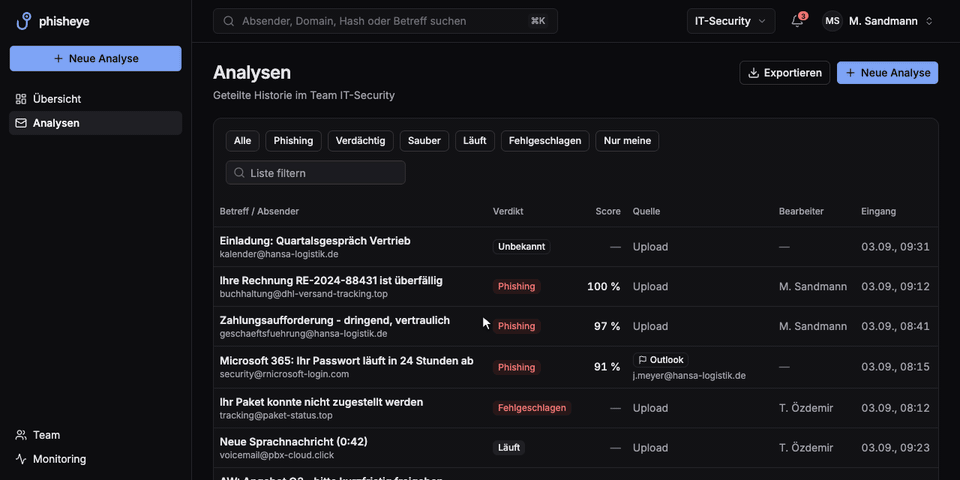

# phisheye 🎣👁️

[](https://github.com/teamphive/phisheye/actions/workflows/backend-ci.yml)
[](https://github.com/teamphive/phisheye/actions/workflows/frontend-ci.yml)

**Problem:** Wer eine verdächtige Mail bekommt, muss Header, Links und Anhänge von Hand prüfen. Das dauert und fällt vielen schwer.

**Lösung:** `.eml` oder `.msg` hochladen oder mail an passende E-Mail-Adresse weiterleiten, phisheye prüft mit Regeln, VirusTotal und KI (JEV) und liefert ein Verdikt (sauber, verdächtig, Phishing) mit Score und Gründen. Für Teams mit Rollen und Zwei-Faktor.



## Schnellstart

```bash
cp .env.example .env
just dev
```

Voraussetzungen und erster Login: [`setup.md`](setup.md). Die einzelnen Teile stehen in den READMEs von `backend/`, `frontend/` und `infra/main/`.

`just dev` startet den kompletten Stack in Docker. Deployment auf den Server: [Infrastruktur](docs/infrastructure.md).

## Mehr

- [Dokumentation](docs/README.md)
- [Techstack](docs/techstack.md)
