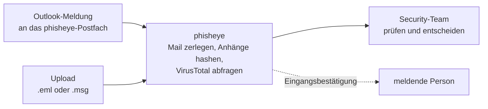

<div align="center">

<picture>
  <source media="(prefers-color-scheme: dark)" srcset="assets/logo/horizontal/phisheye-horizontal-mono-7da3f5.svg">
  
</picture>

**Gemeldete Phishing-Mails an einer Stelle prüfen, entscheiden und nachvollziehen.**

[](https://github.com/teamphive/phisheye/actions/workflows/backend-ci.yml)
[](https://github.com/teamphive/phisheye/actions/workflows/frontend-ci.yml)

</div>

Mitarbeitende leiten verdächtige Mails aus Outlook weiter oder laden sie hoch. phisheye zerlegt jede Mail, gleicht die Anhänge mit VirusTotal ab und legt sie dem zuständigen Security-Team als Analyse vor. Dort wird entschieden, und alle sehen, wer was wann entschieden hat.

<!-- Demo-GIF: neu aufnehmen, sobald Risiko-Score und KI-Einschätzung im Backend laufen (siehe "In Arbeit") -->

## Warum phisheye?

Gemeldete Mails werden oft so geprüft: Die Meldung kommt als Weiterleitung oder Ticket, jemand liest Header und Anhänge von Hand, und das Ergebnis steht danach in einem Postfach oder Chat. Bei vielen Meldungen wird das zum Flaschenhals, und später weiß niemand mehr, wie eine ähnliche Mail damals bewertet wurde.

- **Ein Eingang statt verstreuter Weiterleitungen.** Meldungen aus Outlook und Uploads landen in derselben Liste, beim richtigen Team.
- **Die Routine läuft automatisch.** Header auslesen, Anhänge hashen, VirusTotal fragen: Das ist erledigt, bevor jemand die Analyse öffnet.
- **Entscheidungen bleiben nachvollziehbar.** Jede Analyse zeigt, wer wie entschieden hat. Die Suche findet frühere Fälle zum selben Absender oder Anhang.
- **Die Originalmail bleibt draußen.** Sie liegt getrennt von App und Datenbank in einem eigenen Objektspeicher. Für die Prüfung muss sie niemand im eigenen Mailprogramm öffnen.

## So funktioniert's



## Features

**Meldungen annehmen**

- **Outlook-Meldungen:** Verdächtige Mails gehen an ein gemeinsames Postfach. phisheye ruft es alle 30 Sekunden per POP3 ab oder nimmt Mails per Mailgun-Webhook an.
- **Automatische Zuordnung:** Die Domain der meldenden Adresse bestimmt das Team, Subdomains zählen mit. Meldungen von unbekannten Domains landen im Standard-Team statt verloren zu gehen.
- **Upload:** `.eml` oder Outlook-`.msg` per Drag & Drop, bis 25 MB. Eine `.msg` wandelt phisheye in eine `.eml` um, Dateien ohne Mail darin lehnt es ab.
- **Eingangsbestätigung:** Wer eine Mail meldet, bekommt eine Antwort, dass sie angekommen ist.

**Analysieren**

- **Header und Anhänge:** Alle Header auf einen Blick, jeder Anhang mit Name, Größe und SHA-256.
- **VirusTotal:** Für jeden Anhang zeigt phisheye, wie viele Scanner ihn als schädlich einstufen. Abgefragt wird nur der Hash, die Datei verlässt den Server nicht.

**Im Team arbeiten**

- **Entscheiden:** Analysten stufen eine Mail als Phishing oder sauber ein. Name und Zeitpunkt stehen dabei, die Entscheidung lässt sich zurücknehmen.
- **Suchen:** Mit `⌘K` bzw. `Strg+K` nach Betreff, Absender oder Anhang-Hash suchen, auch in älteren Fällen.
- **Teams und Rollen:** Admin, Analyst und Audit (nur lesen) je Team. Admins laden per Mail ein und tragen die Domains für Outlook-Meldungen ein. Ein Instanz-Admin sieht alle Teams.
- **Anmeldung mit 2FA:** Login über Keycloak mit Authenticator-App und Backup-Codes, die Seiten im phisheye-Design. Konten entstehen nur über eine Einladung.

### In Arbeit

Die Oberfläche dafür steht, das Backend fehlt noch oder liegt auf einem eigenen Branch:

- **Risiko-Score** aus vier Regelprüfungen: SPF/DKIM/DMARC, Linktext gegen Linkziel, Anhang-Typ gegen Endung, From gegen Reply-To. Ergebnis ist sauber, verdächtig oder Phishing, die meldende Person bekommt es per Mail. Details in den [Prüfkriterien](docs/detection-criteria.md).
- **KI-Einschätzung** des Mailtexts mit JEV, unabhängig von den Regeln ([Details](docs/ai-assessment.md)).
- **Analyse im Hintergrund** mit Warteschlange und Fortschritt.
- **Übersicht** mit Kennzahlen, Benachrichtigungen in der App, Analysen übernehmen und die Originalmail herunterladen.

## Schnellstart

### Nur die Oberfläche ansehen

Ohne Docker und ohne Backend, mit Beispieldaten. Braucht Node 22.

```bash
cd frontend
npm install
npm run dev
```

Dann <http://localhost:5173> öffnen. Es gibt keine Anmeldung, und nichts wird wirklich analysiert. Die Beispieldaten zeigen auch Teile, die im Backend noch [in Arbeit](#in-arbeit) sind.

### Kompletter Stack

Braucht Docker (zum Beispiel mit Colima), [just](https://github.com/casey/just) und [uv](https://docs.astral.sh/uv/).

```bash
git clone https://github.com/teamphive/phisheye.git
cd phisheye
cp .env.example .env   # Passwörter setzen, für Anhänge VT_API_KEY eintragen
just dev               # baut und startet alles in Docker
just seed              # legt Test-Accounts an
```

Der erste Build dauert ein paar Minuten. Danach <http://localhost:5173> öffnen und als `analyst@phisheye.example` mit dem Passwort `phisheye` anmelden.

Für Mails mit Anhängen braucht das Backend einen VirusTotal-API-Key, der eines kostenlosen Kontos reicht zum Ausprobieren. Weitere Test-Accounts, Fehlerbehebung und Server-Setup stehen in [`setup.md`](setup.md).

### Erste Analyse

1. Eine Mail als Datei speichern: in Outlook aus dem Posteingang auf den Desktop ziehen (`.msg`), in Gmail „Original herunterladen“, in Thunderbird „Speichern unter“ (`.eml`).
2. In phisheye auf **Neue Analyse** gehen und die Datei ablegen.
3. Die Analyse zeigt Header, Anhänge und den VirusTotal-Befund. Mit **Als Phishing einstufen** oder **Als sauber einstufen** entscheiden.

Für Outlook-Meldungen das Postfach in `.env` eintragen (`POP3_*`) und unter **Team → Outlook-Meldungen** die eigenen Maildomains hinzufügen.

## Techstack

React und TypeScript (Vite, Tailwind, shadcn/ui) · FastAPI mit SQLModel und Alembic · PostgreSQL · Redis mit arq · MinIO · Keycloak · Docker Compose · GitHub Actions

Architektur und Begründungen: [Techstack](docs/techstack.md).

## Dokumentation

- [Setup](setup.md): lokal einrichten, Test-Accounts, Server
- [Dokumentation](docs/README.md): Konzept, Datenmodell, API, Seitenstruktur
- [Infrastruktur](docs/infrastructure.md): Deployment und Betrieb
- [Changelog](CHANGELOG.md)
- Die einzelnen Teile: [`backend/`](backend/README.md), [`frontend/`](frontend/README.md), [`infra/main/`](infra/main/README.md)

## Team

phisheye ist ein Teamprojekt von **teamphive**: Adrijus Lazdauskas, Tom Lammers und Oliver Neumann.
