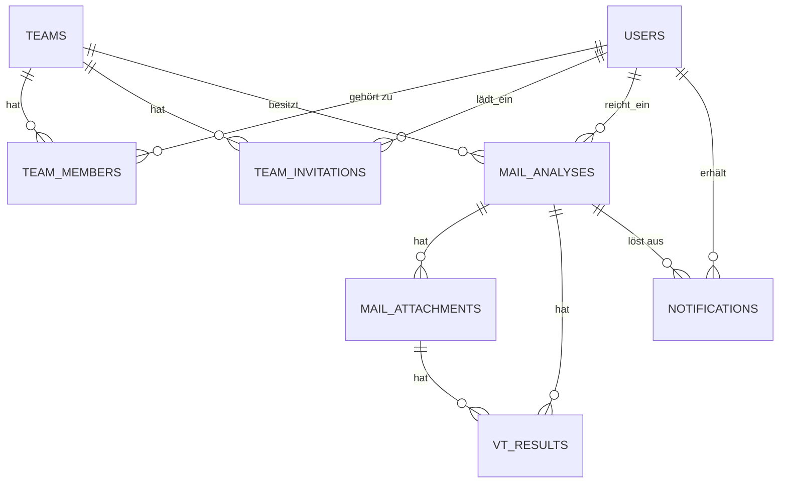

# Datenbankschema

## users

| Spalte | Typ | Beschreibung |
| --- | --- | --- |
| id | PK | |
| email | string, unique | |
| password_hash | string | |
| name | string | |
| totp_secret | string, nullable | für 2FA |
| totp_enabled | bool | |
| is_operator | bool | systemweit, nur für das Monitoring |
| created_at | timestamp | |

## teams

| Spalte | Typ | Beschreibung |
| --- | --- | --- |
| id | PK | |
| name | string | |
| created_at | timestamp | |

## team_members (many-to-many User <-> Team)

| Spalte | Typ | Beschreibung |
| --- | --- | --- |
| id | PK | |
| team_id | FK -> teams | |
| user_id | FK -> users | |
| role | enum (admin, analyst, audit) | gilt nur in diesem Team |
| joined_at | timestamp | |
| | unique constraint | (team_id, user_id) |

## team_invitations

| Spalte | Typ | Beschreibung |
| --- | --- | --- |
| id | PK | |
| team_id | FK -> teams | |
| email | string | eingeladene Adresse, evtl. noch kein User |
| invited_by | FK -> users | |
| status | enum (pending, accepted, expired) | |
| token | string | für den Einladungslink |
| created_at | timestamp | |

## mail_analyses

| Spalte | Typ | Beschreibung |
| --- | --- | --- |
| id | PK | |
| team_id | FK -> teams | |
| submitted_by | FK -> users | |
| subject | string | |
| sender | string | |
| raw_headers | text/JSON | |
| status | enum (pending, processing, completed, failed) | |
| verdict | enum (phishing, clean, suspicious), nullable | bis Analyse fertig |
| confidence_score | float, nullable | |
| decided_verdict | enum (phishing, clean), nullable | vom Analysten bestätigt oder als falsch-positiv gemeldet |
| decided_by | FK -> users, nullable | |
| decided_at | timestamp, nullable | zurücknehmbar, dann wieder null |
| created_at | timestamp | |
| completed_at | timestamp, nullable | |

## mail_attachments

| Spalte | Typ | Beschreibung |
| --- | --- | --- |
| id | PK | |
| mail_analysis_id | FK -> mail_analyses | |
| filename | string | |
| file_hash | string | sha256 |
| mime_type | string | |
| created_at | timestamp | |

## vt_results

| Spalte | Typ | Beschreibung |
| --- | --- | --- |
| id | PK | |
| attachment_id | FK -> mail_attachments, nullable | |
| mail_analysis_id | FK -> mail_analyses, nullable | für URL/Domain-Checks ohne Attachment |
| indicator_type | enum (hash, domain, url, ip) | |
| indicator_value | string | |
| vt_verdict | string | |
| vt_raw_response | JSON | |
| checked_at | timestamp | |

## notifications

| Spalte | Typ | Beschreibung |
| --- | --- | --- |
| id | PK | |
| user_id | FK -> users | |
| mail_analysis_id | FK -> mail_analyses, nullable | |
| message | string | |
| read | bool | |
| created_at | timestamp | |

## Entity-Relationship-Modell

Nur die Beziehungen. Die Spalten stehen in den Tabellen oben.

