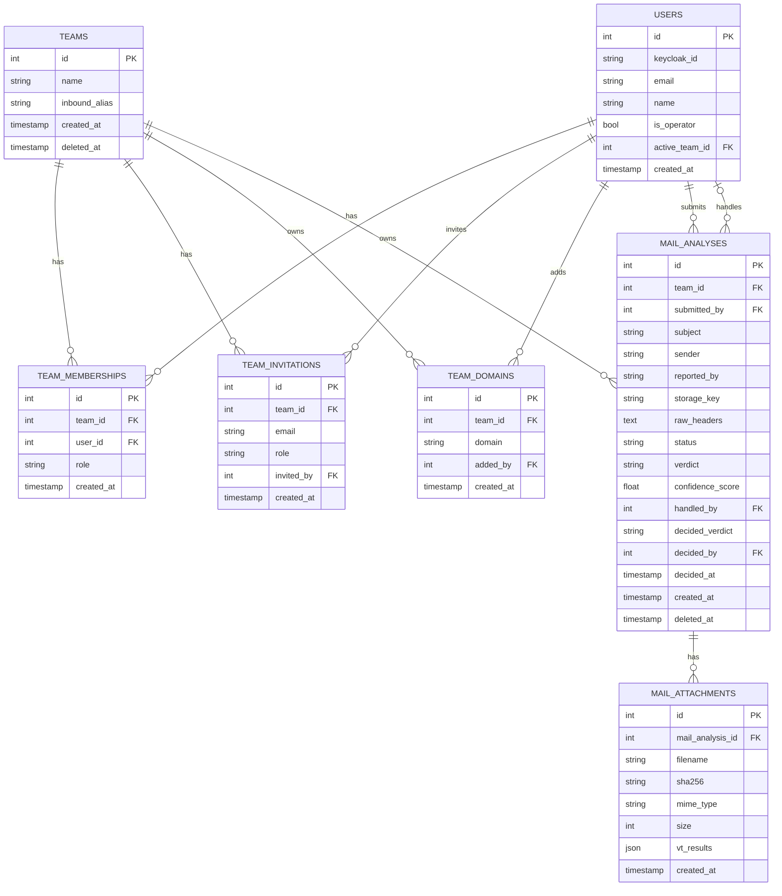

# Datenbankschema

Stand: Modelle in `backend/app/models`. Geplantes steht unten unter "Geplant".

## users

| Spalte | Typ | Beschreibung |
| --- | --- | --- |
| id | PK | |
| keycloak_id | string, unique, nullable | Verknüpfung zum Keycloak-Konto |
| email | string, unique | |
| password_hash | string | ungenutzt, das Passwort liegt in Keycloak |
| name | string | |
| totp_secret | string, nullable | ungenutzt, 2FA liegt in Keycloak |
| totp_enabled | bool | ungenutzt, siehe oben |
| is_operator | bool | systemweit, nur für das Monitoring |
| active_team_id | FK -> teams, nullable | aktives Team, alle Team-Routen antworten dafür |
| created_at | timestamp | |

## teams

| Spalte | Typ | Beschreibung |
| --- | --- | --- |
| id | PK | |
| name | string | |
| inbound_alias | string, unique, nullable | Adresse für Outlook-Meldungen |
| created_at | timestamp | |
| deleted_at | timestamp, nullable | weich gelöscht, harte Löschung nach 10 Tagen |

## team_memberships (many-to-many User <-> Team)

| Spalte | Typ | Beschreibung |
| --- | --- | --- |
| id | PK | |
| team_id | FK -> teams | |
| user_id | FK -> users | |
| role | string (admin, analyst, audit) | gilt nur in diesem Team. Im Standard-Team nur `admin` und `audit`, beide sind Instanz-Rollen für alle Teams |
| created_at | timestamp | |
| | unique constraint | (team_id, user_id) |

## team_invitations

| Spalte | Typ | Beschreibung |
| --- | --- | --- |
| id | PK | |
| team_id | FK -> teams | |
| email | string | eingeladene Adresse (klein geschrieben), das Konto kann noch fehlen |
| role | string (admin, analyst, audit) | gilt, sobald die Person sich anmeldet |
| invited_by | FK -> users | |
| created_at | timestamp | |
| | unique constraint | (team_id, email) |

## team_domains

| Spalte | Typ | Beschreibung |
| --- | --- | --- |
| id | PK | |
| team_id | FK -> teams | |
| domain | string, unique | klein geschrieben, Punycode, gilt samt Subdomains |
| added_by | FK -> users | |
| created_at | timestamp | |

Outlook-Meldungen landen im Team, das die Domain des Absenders eingetragen hat. Sonst nimmt sie das Standard-Team.

## mail_analyses

| Spalte | Typ | Beschreibung |
| --- | --- | --- |
| id | PK | |
| team_id | FK -> teams | |
| submitted_by | FK -> users | bei Outlook-Meldungen der Systemnutzer, die Adresse der meldenden Person steht in `reported_by` |
| subject | string | |
| sender | string | Absender der gemeldeten Mail, nicht der meldenden Person |
| reported_by | string, nullable | Adresse der meldenden Person, nur bei Meldung per Mail |
| storage_key | string, nullable | UUID der gespeicherten `.eml` in MinIO |
| notified_at | timestamp, nullable | Zeitpunkt der letzten Mail an die meldende Person, zählt für die Stundenbegrenzung |
| notified_verdict | string, nullable | Entscheidung, die die meldende Person zuletzt gehört hat. Weicht `decided_verdict` davon ab, geht eine Korrektur raus |
| raw_headers | text, nullable | |
| status | string (pending, processing, completed, failed) | |
| verdict | string (phishing, clean, suspicious), nullable | bis die Analyse fertig ist |
| confidence_score | float, nullable | |
| handled_by | FK -> users, nullable | zugewiesene Person: beim Upload die hochladende, bei Meldungen null bis zur Übernahme. Nie der Systemnutzer |
| decided_verdict | string (phishing, clean), nullable | vom Analysten bestätigt oder als falsch-positiv gemeldet |
| decided_by | FK -> users, nullable | |
| decided_at | timestamp, nullable | zurücknehmbar, dann wieder null |
| created_at | timestamp | |
| deleted_at | timestamp, nullable | weich gelöscht, harte Löschung nach 10 Tagen |

## mail_attachments

| Spalte | Typ | Beschreibung |
| --- | --- | --- |
| id | PK | |
| mail_analysis_id | FK -> mail_analyses | |
| filename | string | |
| sha256 | string | |
| mime_type | string, nullable | |
| size | int, nullable | Bytes |
| vt_results | JSON, nullable | VirusTotal-Antwort zum Hash |
| created_at | timestamp | |

## Geplant

- `completed_at` an `mail_analyses`: Zeitpunkt, an dem die Analyse fertig ist.
- `ai_verdict`, `ai_confidence`, `ai_model` an `mail_analyses`: KI-Einschätzung, siehe [ai-assessment.md](ai-assessment.md).
- `vt_results` als eigene Tabelle statt JSON am Anhang (auch für URL- und Domain-Checks ohne Anhang):

  | Spalte | Typ | Beschreibung |
  | --- | --- | --- |
  | id | PK | |
  | attachment_id | FK -> mail_attachments, nullable | |
  | mail_analysis_id | FK -> mail_analyses, nullable | für URL- und Domain-Checks ohne Anhang |
  | indicator_type | enum (hash, domain, url, ip) | |
  | indicator_value | string | |
  | vt_verdict | string | |
  | vt_raw_response | JSON | |
  | checked_at | timestamp | |

- `notifications` für die Glocke im Header:

  | Spalte | Typ | Beschreibung |
  | --- | --- | --- |
  | id | PK | |
  | user_id | FK -> users | |
  | mail_analysis_id | FK -> mail_analyses, nullable | |
  | message | string | |
  | read | bool | |
  | created_at | timestamp | |

## Entity-Relationship-Modell

Nur umgesetzte Tabellen.

