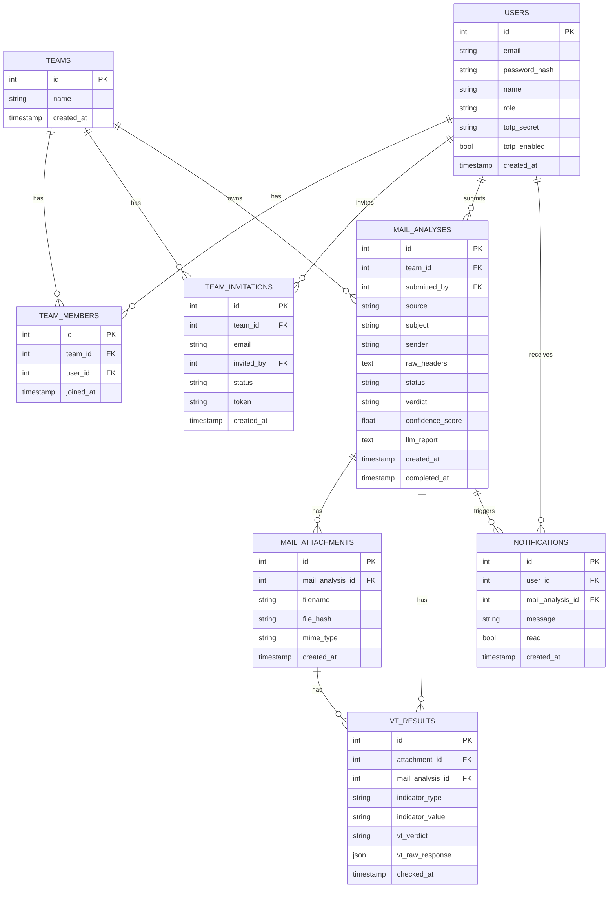

# Projektidee: phisheye

## Problem

Mitarbeiter melden vermeintliche Phishing-Mails, die Cyber Security Abteilung bekommt diese als Ticket bzw. Weiterleitung und muss sie manuell prüfen. Es gibt keinen zentralen Ort im Unternehmen, an dem diese Prüfungen dokumentiert und nachvollziehbar gemacht werden.

## Idee

phisheye ist eine Web-App, in die eine verdächtige Mail eingespielt wird (Upload oder per IMAP/Forwarding), die daraufhin Header und Metadaten werde mit determinitischen regeln [detection-criteria](detection-criteria.md) überprüft und der Attachment-Hashes wird gegen die VirusTotal-API prüft. Das Ergebnis ist ein Verdikt (Phishing ja/nein) mit Confidence Score.

Die App läuft im Unternehmenskontext mit Teamverwaltung, sodass die Cyber Security Abteilung zentral und nachvollziehbar arbeiten kann statt Prüfungen manuell im Ticket-System zu dokumentieren.

## Zielgruppe

Firmenintern, Cyber Security Abteilung als Hauptnutzer. Mitarbeiter melden Mails, das Security-Team prüft und dokumentiert zentral.

## Wahlpflicht-Features

| # | Feature | Punkte | Umsetzung in phisheye |
|---|---------|--------|------------------------|
| 1 | KI-Integration | 2 | LLM bewertet die Analyse-Ergebnisse und erstellt den Bericht im Klartext |
| 2 | Team-Feature inkl. Rollenverwaltung | 2 | Teams mit Rollen (Admin / Analyst), geteilte Analyse-Historie |
| 3 | Benachrichtigungs-System (Glocke) | 2 | Hinweis in der App, sobald eine Analyse abgeschlossen ist |
| 4 | Such-System (Suchfunktion) | 2 | Suche über Absender, Domains, Hashes und frühere Analysen |
| 5 | Background-Jobs / asynchrone Verarbeitung | 1 | Analyse läuft über arq + Redis, nicht im Request |
| 6 | Anbindung an externe APIs | 1 | VirusTotal-API für Hash- und Datei-Reputation |
| 7 | Zwei-Faktor-Authentifizierung (2FA) | 1 | TOTP zusätzlich zum Login |
| 8 | Monitoring-System (Admin-Dashboard) | 1 | Systemauslastung, Queue-Status, Fehlerraten |
|   | **Summe** | **12** | |

## Datenbankschema

