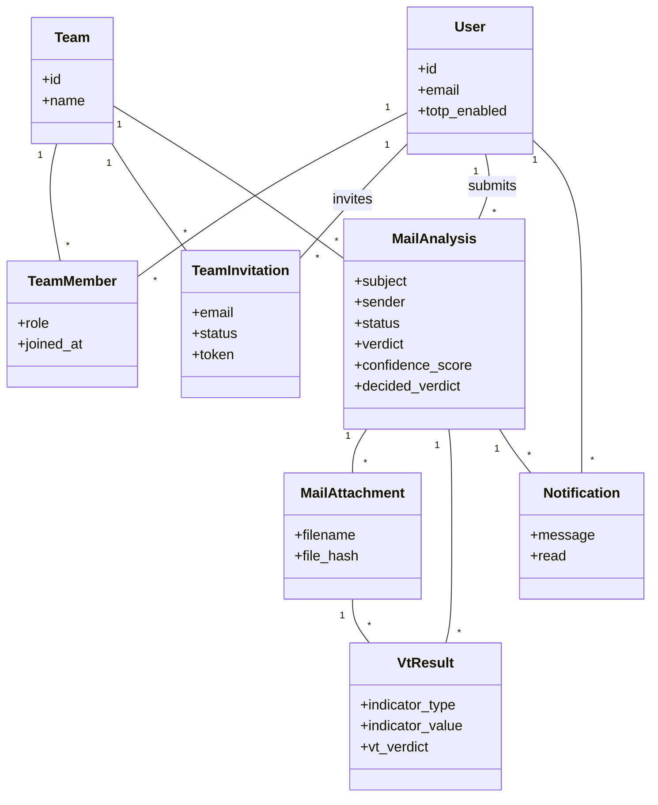

# Projektidee: phisheye

## Problem

Mitarbeiter melden vermeintliche Phishing-Mails, die Cyber Security Abteilung bekommt diese als Ticket bzw. Weiterleitung. Die Prüfung erfolgt aktuell manuell: Header und Anhänge müssen von Hand analysiert werden, was Zeit kostet und bei hohem Meldeaufkommen zum Flaschenhals wird.

## Idee

phisheye ist eine Web-App, in die eine verdächtige Mail hochgeladen wird. Header und Metadaten werden mit deterministischen Regeln geprüft, die Anhang-Hashes gegen die VirusTotal-API. Das Ergebnis ist ein Verdikt mit Score: sauber, verdächtig oder Phishing.

Die App automatisiert damit den bisher manuellen Prüfschritt und läuft im Unternehmenskontext mit Teamverwaltung, sodass die Cyber Security Abteilung die Ergebnisse zentral einsehen und weiterbearbeiten kann.

## Zielgruppe

Firmenintern, Cyber Security Abteilung als Hauptnutzer. Mitarbeiter melden Mails, das Security-Team prüft und dokumentiert zentral.

## Techstack

- Backend: FastAPI, SQLModel + Alembic, PostgreSQL
- Frontend: React + TypeScript (Vite), Tailwind, shadcn/ui
- Jobs: arq + Redis
- Extern: VirusTotal-API, AWS Bedrock (LLM)
- Infra: Homelab (Docker Compose, Nginx Proxy Manager), AWS nur für Bedrock + Budget (OpenTofu)
- CI/CD: GitHub Actions

## KI-Integration

Neben den deterministischen Regeln wertet ein Sprachmodell den Text der Mail aus. Es beurteilt die Sprache auf Muster, die sich nicht in Regeln fassen lassen, etwa Zeitdruck, Drohungen oder Aufforderungen zur Herausgabe von Zugangsdaten, und liefert daraus eine eigene Einschätzung zum Verdikt.

Wie das technisch umgesetzt wird, ist noch offen.

## Wahlpflicht-Features

| # | Feature | Punkte |
| --- | --------- | -------- |
| 1 | KI-Integration | 2 |
| 2 | Team-Feature inkl. Rollenverwaltung | 2 |
| 3 | Benachrichtigungs-System | 2 |
| 4 | Such-System | 2 |
| 5 | Background-Jobs | 1 |
| 6 | Anbindung an externe APIs | 1 |
| 7 | Zwei-Faktor-Authentifizierung | 1 |
| 8 | Monitoring-System | 1 |
| | **Summe** | **12** |

## Datenbankschema

### Tabellen

#### users

| Spalte | Typ | Beschreibung |
| --- | --- | --- |
| id | PK | |
| email | string, unique | |
| password_hash | string | |
| name | string | |
| totp_secret | string, nullable | für 2FA |
| totp_enabled | bool | |
| is_operator | bool | systemweit, nur für das Monitoring |
| created_at | timestamp | |

#### teams

| Spalte | Typ | Beschreibung |
| --- | --- | --- |
| id | PK | |
| name | string | |
| created_at | timestamp | |

#### team_members (many-to-many User <-> Team)

| Spalte | Typ | Beschreibung |
| --- | --- | --- |
| id | PK | |
| team_id | FK -> teams | |
| user_id | FK -> users | |
| role | enum (admin, analyst, audit) | gilt nur in diesem Team |
| joined_at | timestamp | |
| | unique constraint | (team_id, user_id) |

#### team_invitations

| Spalte | Typ | Beschreibung |
| --- | --- | --- |
| id | PK | |
| team_id | FK -> teams | |
| email | string | eingeladene Adresse, evtl. noch kein User |
| invited_by | FK -> users | |
| status | enum (pending, accepted, expired) | |
| token | string | für den Einladungslink |
| created_at | timestamp | |

#### mail_analyses

| Spalte | Typ | Beschreibung |
| --- | --- | --- |
| id | PK | |
| team_id | FK -> teams | |
| submitted_by | FK -> users | |
| subject | string | |
| sender | string | |
| raw_headers | text/JSON | |
| status | enum (pending, processing, completed, failed) | |
| verdict | enum (phishing, clean, suspicious), nullable | bis Analyse fertig |
| confidence_score | float, nullable | |
| decided_verdict | enum (phishing, clean), nullable | vom Analysten bestätigt oder als falsch-positiv gemeldet |
| decided_by | FK -> users, nullable | |
| decided_at | timestamp, nullable | zurücknehmbar, dann wieder null |
| created_at | timestamp | |
| completed_at | timestamp, nullable | |

#### mail_attachments

| Spalte | Typ | Beschreibung |
| --- | --- | --- |
| id | PK | |
| mail_analysis_id | FK -> mail_analyses | |
| filename | string | |
| file_hash | string | sha256 |
| mime_type | string | |
| created_at | timestamp | |

#### vt_results

| Spalte | Typ | Beschreibung |
| --- | --- | --- |
| id | PK | |
| attachment_id | FK -> mail_attachments, nullable | |
| mail_analysis_id | FK -> mail_analyses, nullable | für URL/Domain-Checks ohne Attachment |
| indicator_type | enum (hash, domain, url, ip) | |
| indicator_value | string | |
| vt_verdict | string | |
| vt_raw_response | JSON | |
| checked_at | timestamp | |

#### notifications

| Spalte | Typ | Beschreibung |
| --- | --- | --- |
| id | PK | |
| user_id | FK -> users | |
| mail_analysis_id | FK -> mail_analyses, nullable | |
| message | string | |
| read | bool | |
| created_at | timestamp | |

