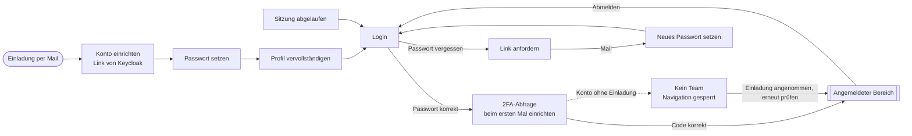
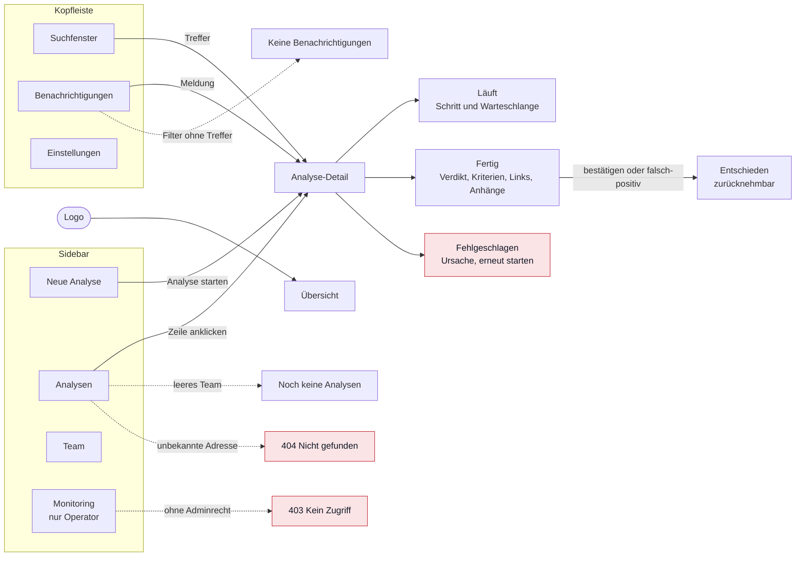

# Seitenstruktur

Die Seiten der App liegen in `frontend/src/pages`. Login, 2FA und Passwörter zeigt Keycloak selbst, im phisheye-Design aus `frontend/src/keycloak-theme`. Der ursprüngliche Entwurf liegt in [mockup.html](../assets/mockup.html).

## Zugang

Es gibt keine Selbstregistrierung. Konten entstehen über die Einladung eines Admins: Keycloak schickt einen Link, darüber setzt die Person Passwort und Profil, beim ersten Login richtet sie 2FA ein. Danach ist sie Mitglied des einladenden Teams. Ein Konto ohne Einladung landet im Zustand ohne Team. Teams legt nur der Instanz-Admin an, alle anderen warten dort auf eine Einladung: „Erneut prüfen“ fragt den Server neu, die Einladung wird mit der nächsten Anfrage angenommen. Daneben gibt es nur Abmelden.

## Wege im angemeldeten Bereich

Gestrichelte Pfeile führen zu Sonderfällen, nicht zu regulären Seiten. Overlays haben keine eigene Adresse und stehen nicht im Diagramm: Suchfenster, Glocken-Menü, Team-Umschalter sowie die Dialoge für Einladen, Team erstellen, Mitglied entfernen, Domain entfernen, Team verlassen und löschen, Analyse löschen und aktive Sitzungen. Passwort, 2FA und Backup-Codes ändert man auf den Seiten von Keycloak.

## Angemeldet

Sidebar und Kopfleiste sind auf allen Seiten gleich.

| Seite | Pfad | Erreichbar über |
|-------|------|-----------------|
| Übersicht | `/` | Startseite nach dem Login, Klick aufs Logo |
| Neue Analyse | `/analysen/neu` | Button oben in der Sidebar |
| Analysen | `/analysen` | Sidebar |
| Analyse-Detail | `/analysen/:id` | Zeile in der Liste, Suchtreffer, Benachrichtigung |
| Team | `/team` | Sidebar |
| Monitoring | `/monitoring` | Sidebar unten, systemweit über alle Teams |
| Benachrichtigungen | `/benachrichtigungen` | Glocke |
| Einstellungen | `/einstellungen` | Profil oben rechts |
| Kein Zugriff | 403 | Aufruf ohne Berechtigung |
| Nicht gefunden | 404 | unbekannte Adresse, gelöschte Analyse |

## Ohne Login

Diese Seiten liefert Keycloak unter `/auth/realms/phisheye/` aus, im Design aus `frontend/src/keycloak-theme`.

| Seite | Keycloak-Seite | Erreichbar über |
|-------|----------------|-----------------|
| Login | `login.ftl` | jeder Aufruf ohne Anmeldung, Abmelden, abgelaufene Sitzung |
| 2FA-Abfrage | `login-otp.ftl` | nach korrektem Passwort |
| Anmeldemethode wählen | `select-authenticator.ftl` | „Andere Methode“ auf der 2FA-Abfrage |
| Backup-Code eingeben | `login-recovery-authn-code-input.ftl` | Anmeldemethode Backup-Code |
| Passwort vergessen | `login-reset-password.ftl` | Link auf der Login-Seite |
| Neues Passwort | `login-update-password.ftl` | Link aus der Mail, Einrichtung nach einer Einladung, Einstellungen |
| Konto einrichten | `info.ftl` | Link aus Keycloaks Mail nach einer Einladung, zeigt die Schritte und am Ende den Abschluss |
| Profil vervollständigen | `login-update-profile.ftl` | Einrichtung nach einer Einladung |
| 2FA einrichten | `login-config-totp.ftl` | erster Login, Einstellungen |
| Backup-Codes sichern | `login-recovery-authn-code-config.ftl` | Einstellungen |
| E-Mail-Adresse bestätigen | `login-verify-email.ftl` | wenn Keycloak eine Bestätigung verlangt |
| Gerät entfernen | `delete-credential.ftl` | Einstellungen, „Entfernen“ bei einer Authenticator-App |
| Fehler | `error.ftl` | abgelaufener oder schon benutzter Link |
| Seite abgelaufen | `login-page-expired.ftl` | Login zu lange offen oder in einem anderen Tab weiter |
| Abmelden bestätigen | `logout-confirm.ftl` | Abmelden ohne Token, die App selbst überspringt die Seite |

Zur App gehört nur „Sitzung abgelaufen“ unter `/sitzung-abgelaufen`. Sie erscheint, wenn sich die Anmeldung nicht mehr erneuern lässt, und führt zurück zum Login.

## Rollen

Die Rolle gilt pro Team, nicht pro Nutzer. Dieselbe Person kann in einem Team Admin sein und in einem anderen nur lesen.

| Recht | Analyst | Admin | Audit |
|-------|:-------:|:-----:|:-----:|
| Analysen des Teams sehen und durchsuchen | ✓ | ✓ | ✓ |
| Mails hochladen und analysieren | ✓ | ✓ | — |
| Verdikt bestätigen oder als falsch-positiv melden | ✓ | ✓ | — |
| Analysen löschen | — | ✓ | — |
| Mitglieder einladen, Rollen ändern, entfernen | — | ✓ | — |
| Team umbenennen und löschen | — | ✓ | — |
| Domains für Outlook-Meldungen eintragen und entfernen | — | ✓ | — |

**Audit** darf ausschließlich lesen. Für diese Rolle blendet die Oberfläche „Neue Analyse", die Verdikt-Knöpfe und die gesamte Team-Verwaltung aus.

Dazu kommen die **Instanz-Rollen** im Standard-Team. Dort gibt es nur Admin und Auditor, keine Analysten:

| Recht | Instanz-Admin | Instanz-Auditor |
|-------|:-------------:|:---------------:|
| Alle Teams sehen | ✓ | ✓ |
| In fremden Teams ändern | ✓ | — |
| Teams erstellen | ✓ | — |
| Monitoring sehen | ✓ | — |

In fremden Teams hat der Instanz-Admin die Rolle Admin und der Auditor die Rolle Audit. Das Standard-Team selbst nimmt die Meldungen von Domains auf, die kein Team eingetragen hat. Es lässt sich nicht umbenennen oder löschen.

Das Monitoring steuert das Merkmal `is_operator`. Es gilt für Instanz-Admins automatisch und lässt sich zusätzlich über die Keycloak-Rolle `operator` vergeben.

In der Oberfläche zeigt der Team-Umschalter oben die eigenen Teams und darunter unter „Weitere Teams“ alle, in denen das Instanz-Mitglied selbst nicht Mitglied ist (`via_instance`), mit gestricheltem Kürzel. In einem solchen Team nennt die Kopfleiste die Instanz-Rolle, die Team-Seite weist darauf hin, dass das Betreten protokolliert wird, und „Team verlassen“ fehlt. Im Standard-Team fehlen Umbenennen und Löschen. Einladen und Rollenwahl bieten dort nur Audit (vorausgewählt) und Admin, mit dem Hinweis, dass beide die Mails aller Teams sehen. „Team erstellen“ erscheint nur bei `can_create_teams`.

Durchgesetzt wird all das im Backend. Die Oberfläche blendet nur aus.

## Overlays

Keine eigene Adresse, kein Router-Eintrag: Suchfenster (`Cmd/Strg + K`), Glocken-Menü, Team-Umschalter sowie die Dialoge für Mitglied einladen, Team erstellen, Mitglied entfernen, Domain entfernen, Team verlassen, Team löschen, Analyse löschen und aktive Sitzungen. Passwort, 2FA und Backup-Codes ändert man auf den Seiten von Keycloak.

## Zustände

| Zustand | Wo |
|---------|-----|
| Kein Team | eigener Bildschirm statt der App, bei einem Konto ohne Einladung. „Erneut prüfen“ und Abmelden, „Team erstellen“ nur für den Instanz-Admin |
| Fremdes Team | Team, Hinweis für Instanz-Mitglieder, die dort nicht selbst Mitglied sind |
| Analyse läuft | Analyse-Detail, mit Warteschlange darunter |
| Analyse fehlgeschlagen | Analyse-Detail, Ursache. Operatoren reihen den Job im Monitoring neu ein |
| Verdikt entschieden | Analyse-Detail, zurücknehmbar |
| Noch keine Analysen | Analysen und Übersicht im frisch angelegten Team |
| Keine Domain eingetragen | Team, Karte „Outlook-Meldungen", es kommen keine Meldungen an |
| Keine Benachrichtigungen | Benachrichtigungen, wenn ein Filter nichts trifft |
| Suche ohne Treffer | Suchfenster |
| Ladezustand | Analysenliste beim Öffnen und beim Teamwechsel |

## Entschieden

- Ein Verdikt ist zurücknehmbar, eine Begründung wird nicht erfasst.
- Die Fortschrittsanzeige zeigt Status, aktuellen Schritt als Text und verstrichene Zeit. Kein Prozentwert, keine Schrittnummern, keine Zeiten je Schritt. Die API braucht dafür nur `status`, `step` und `started_at`.
- Die Rolle hängt an der Verknüpfung Nutzer–Team, nicht am Nutzer.
- Jeder Nutzer gehört mindestens einem Team an. Das Verlassen des letzten Teams lehnt die API ab.
- Jedes Team hat immer mindestens einen Admin. Der letzte Admin kann sich weder herabstufen noch entfernen lassen.
- Gemeldete Mails landen über die Domain der meldenden Adresse im Team. Eine Domain gehört höchstens einem Team, Subdomains zählen mit, ein Nachweis des Domainbesitzes ist nicht vorgesehen. Die Liste sehen alle Rollen, ändern dürfen sie nur Admins.
- Das Monitoring zeigt systemweite Werte über alle Teams hinweg. Der Endpunkt ist deshalb nicht unter einem Team eingehängt, sondern `GET /monitoring`, und die Fehlerliste enthält keine Mailinhalte.
- **Der Team-Kontext kommt aus der Sitzung, nicht aus dem Pfad.** Die Endpunkte heißen `/analyses`, nicht `/teams/{id}/analyses`. Der Umschalter ändert den serverseitigen Kontext, nicht die Adresse.
- **Hochgeladen werden nur `.eml`-Dateien.** Outlooks `.msg` ist ein anderes Format, das Backend liest nur MIME.
- **Löschen ist immer weich.** Teams und Analysen werden als gelöscht markiert und erst nach 10 Tagen endgültig entfernt. Dafür braucht es einen Aufräum-Job.
- **Zeiten liefert die API als ISO 8601 in UTC.** Das Frontend formatiert in die Zeitzone des Browsers.
- **Fehler kommen als einheitliches Objekt**, nicht als FastAPIs Standard-`detail`.
- **Der erste Admin wird beim Initialisieren des Backends angelegt**, nicht über die Oberfläche.

## Offen

- Authentifizierung: Cookie oder Bearer-Token. Betrifft jeden Endpunkt und den gesamten API-Client.
- IDs: UUID oder laufende Nummer. Betrifft das Datenmodell, nicht das Routing.
- Ladezustände für Detailseite, Team und Monitoring. Entstehen beim Bau in React.
