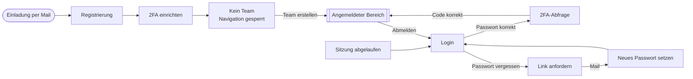

# Seitenstruktur

19 Seiten, 11 Overlays. Die Pfade sind Vorschläge fürs Routing und noch nicht mit dem Backend abgestimmt. Der Entwurf liegt in [mockup.html](mockup.html).

## Zugang

Es gibt keine Selbstregistrierung. Der einzige Weg zu einem Konto führt über die Einladung eines Admins, und der einzige Weg aus dem Zustand ohne Team führt über das Anlegen eines Teams.

## Wege im angemeldeten Bereich

Gestrichelte Pfeile führen zu Sonderfällen, nicht zu regulären Seiten. Overlays haben keine eigene Adresse und stehen nicht im Diagramm: Suchfenster, Glocken-Menü, Team-Umschalter sowie die Dialoge für Einladen, Team erstellen, Mitglied entfernen, Team verlassen und löschen, Analyse löschen, Passwort ändern, Backup-Codes und aktive Sitzungen.

## Angemeldet

Sidebar und Kopfleiste sind auf allen Seiten gleich.

| Seite | Pfad | Erreichbar über |
|-------|------|-----------------|
| Übersicht | `/` | Startseite nach dem Login, Klick aufs Logo |
| Neue Analyse | `/analysen/neu` | Button oben in der Sidebar |
| Analysen | `/analysen` | Sidebar |
| Analyse-Detail | `/analysen/:id` | Zeile in der Liste, Suchtreffer, Benachrichtigung |
| Team | `/team` | Sidebar |
| Monitoring | `/monitoring` | Sidebar unten, systemweit über alle Teams |
| Benachrichtigungen | `/benachrichtigungen` | Glocke |
| Einstellungen | `/einstellungen` | Profil oben rechts |
| Kein Zugriff | 403 | Aufruf ohne Berechtigung |
| Nicht gefunden | 404 | unbekannte Adresse, gelöschte Analyse |

## Ohne Login

| Seite | Pfad | Erreichbar über |
|-------|------|-----------------|
| Login | `/login` | Abmelden, abgelaufene Sitzung |
| 2FA-Abfrage | `/login/2fa` | nach korrektem Passwort |
| Registrierung | `/registrierung?token=…` | nur über den Einladungslink, keine Selbstregistrierung |
| 2FA einrichten | `/einrichtung/2fa` | nach der Registrierung, aus den Einstellungen |
| Passwort vergessen | `/passwort-vergessen` | Link auf der Login-Seite |
| Passwort zurücksetzen | `/passwort-neu?token=…` | Link aus der E-Mail |
| Sitzung abgelaufen | `/login?abgelaufen=1` | nach 30 Minuten ohne Aktivität |

## Rollen

Die Rolle gilt pro Team, nicht pro Nutzer. Dieselbe Person kann in einem Team Admin sein und in einem anderen nur lesen.

| Recht | Analyst | Admin | Audit |
|-------|:-------:|:-----:|:-----:|
| Analysen des Teams sehen und durchsuchen | ✓ | ✓ | ✓ |
| Mails hochladen und analysieren | ✓ | ✓ | — |
| Verdikt bestätigen oder als falsch-positiv melden | ✓ | ✓ | — |
| Analysen löschen | — | ✓ | — |
| Mitglieder einladen, Rollen ändern, entfernen | — | ✓ | — |
| Team umbenennen und löschen | — | ✓ | — |

**Audit** darf ausschließlich lesen. Für diese Rolle blendet die Oberfläche „Neue Analyse", die Verdikt-Knöpfe und die gesamte Team-Verwaltung aus.

Davon getrennt gibt es ein systemweites Merkmal `is_operator` am Nutzer. Es steuert allein den Zugriff aufs Monitoring und hat mit den Team-Rollen nichts zu tun — ein Team-Admin ist nicht automatisch Operator.

Durchgesetzt wird all das im Backend. Die Oberfläche blendet nur aus.

## Overlays

Keine eigene Adresse, kein Router-Eintrag: Suchfenster (`Cmd/Strg + K`), Glocken-Menü, Team-Umschalter sowie die Dialoge für Mitglied einladen, Team erstellen, Mitglied entfernen, Team verlassen, Team löschen, Analyse löschen, Passwort ändern, Backup-Codes und aktive Sitzungen.

## Zustände

| Zustand | Wo |
|---------|-----|
| Kein Team | Team, direkt nach der Registrierung, Navigation gesperrt |
| Analyse läuft | Analyse-Detail, mit Warteschlange darunter |
| Analyse fehlgeschlagen | Analyse-Detail, Ursache und erneut starten |
| Verdikt entschieden | Analyse-Detail, zurücknehmbar |
| Noch keine Analysen | Analysen und Übersicht im frisch angelegten Team |
| Keine Benachrichtigungen | Benachrichtigungen, wenn ein Filter nichts trifft |
| Suche ohne Treffer | Suchfenster |
| Ladezustand | Analysenliste beim Öffnen und beim Teamwechsel |

## Entschieden

- Ein Verdikt ist zurücknehmbar, eine Begründung wird nicht erfasst.
- Die Fortschrittsanzeige zeigt Status, aktuellen Schritt als Text und verstrichene Zeit. Kein Prozentwert, keine Schrittnummern, keine Zeiten je Schritt. Die API braucht dafür nur `status`, `step` und `started_at`.
- Die Rolle hängt an der Verknüpfung Nutzer–Team, nicht am Nutzer.
- Jeder Nutzer gehört mindestens einem Team an. Das Verlassen des letzten Teams lehnt die API ab.
- Jedes Team hat immer mindestens einen Admin. Der letzte Admin kann sich weder herabstufen noch entfernen lassen.
- Das Monitoring zeigt systemweite Werte über alle Teams hinweg. Der Endpunkt ist deshalb nicht unter einem Team eingehängt, sondern `GET /monitoring`, und die Fehlerliste enthält keine Mailinhalte.
- **Der Team-Kontext kommt aus der Sitzung, nicht aus dem Pfad.** Die Endpunkte heißen `/analyses`, nicht `/teams/{id}/analyses`. Der Umschalter ändert den serverseitigen Kontext, nicht die Adresse.
- **`.eml` und `.msg` werden beide unterstützt.**
- **Löschen ist immer weich.** Teams und Analysen werden als gelöscht markiert und erst nach 10 Tagen endgültig entfernt. Dafür braucht es einen Aufräum-Job.
- **Zeiten liefert die API als ISO 8601 in UTC.** Das Frontend formatiert in die Zeitzone des Browsers.
- **Fehler kommen als einheitliches Objekt**, nicht als FastAPIs Standard-`detail`.
- **Der erste Admin wird beim Initialisieren des Backends angelegt**, nicht über die Oberfläche.

## Offen

- Authentifizierung: Cookie oder Bearer-Token. Betrifft jeden Endpunkt und den gesamten API-Client.
- IDs: UUID oder laufende Nummer. Betrifft das Datenmodell, nicht das Routing.
- Ladezustände für Detailseite, Team und Monitoring. Entstehen beim Bau in React.
