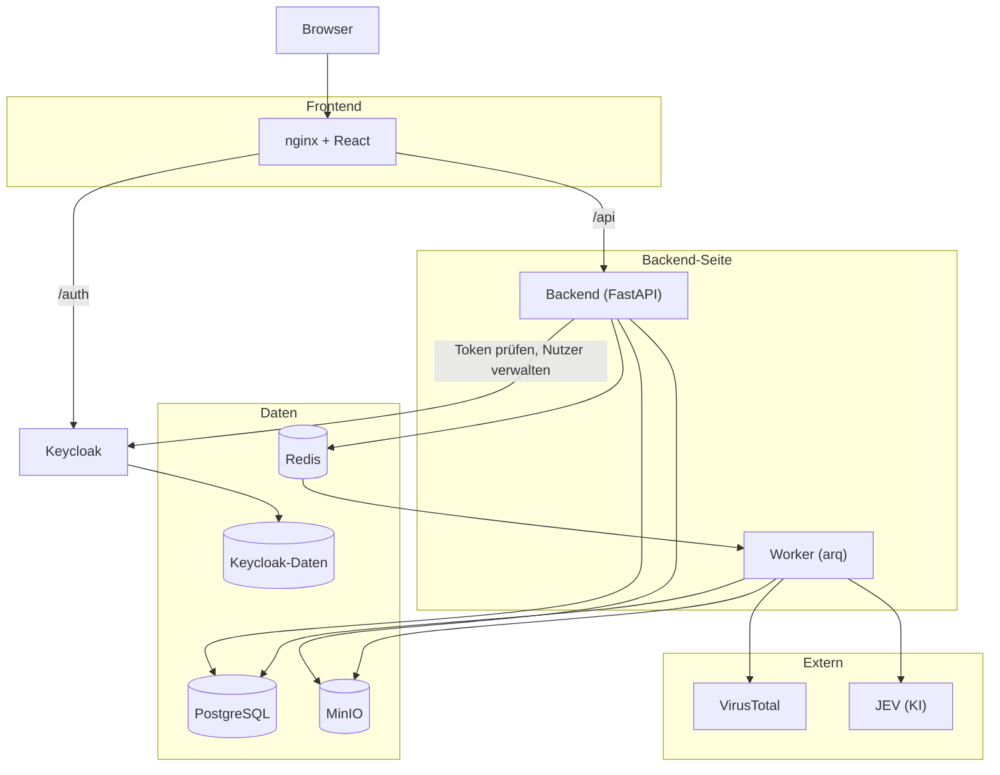
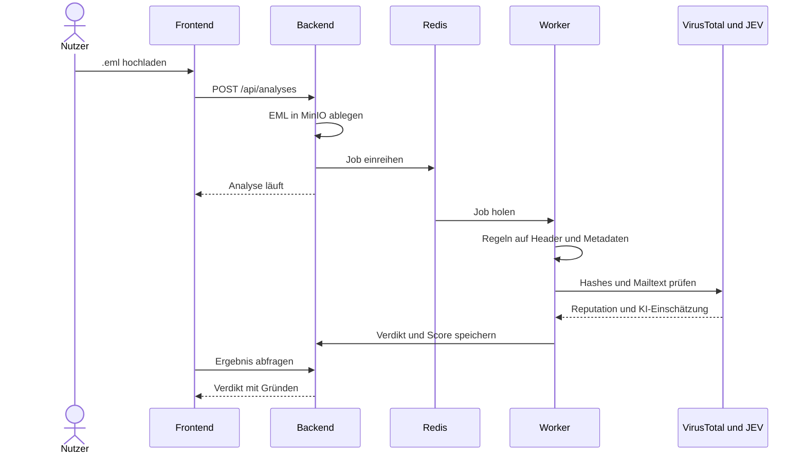

# Techstack

## Architektur

## Ablauf einer Analyse

Zielbild. Stand heute läuft die Analyse noch synchron im Request, Worker, Regeln und KI kommen nach, siehe [API](api.md).

## Bausteine

| Technik | Zweck | Warum |
| --- | --- | --- |
| React, TypeScript, Vite | Oberfläche | Typen fangen Fehler früh ab, schneller Dev-Server |
| Tailwind, shadcn/ui | Styling und Komponenten | Komponenten liegen im eigenen Code und lassen sich anpassen |
| nginx | Auslieferung, Proxy für `/api` und `/auth` | Ein Host für alles, kein CORS |
| FastAPI | REST-API | Async, Validierung und OpenAPI eingebaut |
| SQLModel, Alembic | Modelle und Migrationen | Ein Modell für Datenbank und API |
| PostgreSQL | Analysen, Teams, Nutzer | Relationale Daten mit klaren Beziehungen |
| MinIO (S3) | Ablage der EML-Dateien | Schädliche Dateien getrennt von der App, eigenes Rechtekonzept, siehe [ADR](adr-eml-storage.md) |
| arq, Redis | Analyse im Hintergrund | Der Request bleibt schnell, leichtgewichtig und async wie FastAPI |
| Keycloak, Keycloakify | Login, Rollen, Zwei-Faktor | Fertige Nutzerverwaltung statt Eigenbau, eigenes Login-Theme |
| VirusTotal | Reputation von Anhängen | Hash-Abfrage ohne den Anhang selbst hochzuladen |
| JEV (TypeSafe) | KI-Einschätzung des Mailtexts | Feste Antwort mit Konfidenz statt Freitext, siehe [KI-Einschätzung](ai-assessment.md) |
| Docker Compose | Betrieb | Ein Stack lokal und auf dem Server |
| Homelab, Nginx Proxy Manager | Hosting und Reverse Proxy | Kostenlos und volle Kontrolle, AWS nur für das Budget, siehe [Infrastruktur](infrastructure.md) |
| GitHub Actions, GHCR | CI/CD und Images | Direkt am Repo, siehe [Release](release.md) |
